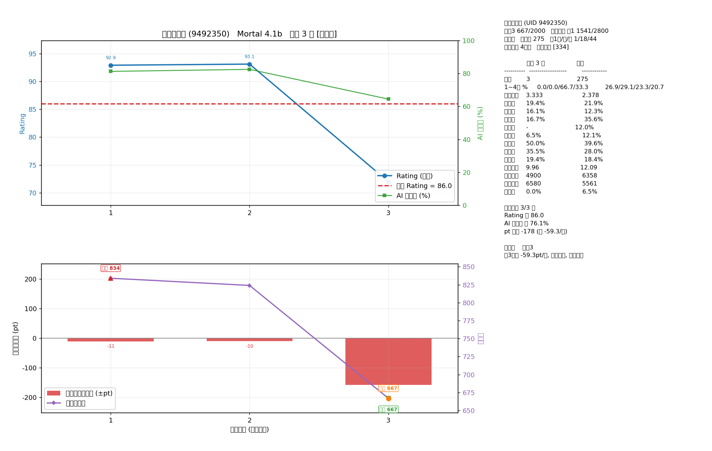

# 雀魂 Mortal Rating 批量跑谱（桌面版）

输入雀魂 UID 或昵称，程序自动拉取最近的对局，逐局提交到 [mjai.ekyu.moe](https://mjai.ekyu.moe) 用 Mortal 4.1b 跑谱，取回每局的 **Rating** 和 **AI 一致率**，并生成走势图与差异报告。

本仓库有两个版本：

| 版本 | 位置 | 说明 |
|---|---|---|
| 桌面版（本文） | 仓库根目录 | Windows，tkinter 界面（`gui.py`），Playwright 驱动本机 Edge/Chrome |
| 安卓版 | [`majsoul-android/`](majsoul-android/README.md) | PySide6 + QML，用程序内 WebView 替代浏览器，打包成 APK |

## 截图

| 主图（Rating 走势、AI 一致率、每局 pt、战绩概览） |
|---|
|  |

安卓版的界面截图见 [`majsoul-android/README.md`](majsoul-android/README.md)。

## 功能

1. 从雀魂牌谱屋（amae-koromo）取对局列表和战绩概览，可按场次类型筛选。
2. 逐局提交 mjai.ekyu.moe，用 Mortal 4.1b 跑谱，取每局 Rating 和 AI 一致率。
3. 输出明细 CSV 和一张图。上图是 Rating 与 AI 一致率曲线，下图是每局段位分变化（±pt）和走势，右侧是「最近 N 场」与「总体」两套战绩。
4. 生成差异报告：列出你的选择与 AI 不同的局面，附牌桌、向听数和进张数对比。
5. 玩家数据存在本地，再次运行只补新对局，已跑过的局不重复提交。

## 借鉴与依赖的项目

| 项目 | 用途 | 许可 / 说明 |
|---|---|---|
| [amae-koromo](https://github.com/SAPikachu/amae-koromo) | 雀魂牌谱屋，提供对局记录与统计数据 | 调用其公开接口 |
| [Mortal](https://github.com/Equim-chan/Mortal) | 麻将 AI 引擎，生成 Rating 与 AI 一致率 | 模型权重未公开，只能走线上服务 |
| [mjai-reviewer](https://github.com/Equim-chan/mjai-reviewer) / [mjai.ekyu.moe](https://mjai.ekyu.moe) | 线上跑谱服务与报告格式 | 本项目只提交任务并读取报告 JSON |
| [MahjongRepository/mahjong](https://github.com/MahjongRepository/mahjong) | 向听数计算（`efficiency.py`） | MIT |
| [WarL0ckNet/tile-art](https://github.com/WarL0ckNet/tile-art) | 差异报告里的牌面素材（`assets/pai.svg`） | 素材来源见文件头注释 |
| [Playwright](https://playwright.dev/python/) | 通过 CDP 控制本机浏览器 | Apache-2.0 |
| [Matplotlib](https://matplotlib.org) | 绘制主图 | |
| [Pillow](https://python-pillow.org) | 界面里显示图片 | |
| [PyInstaller](https://pyinstaller.org) | 打包成 exe | 仅构建时需要 |
| [Inno Setup](https://jrsoftware.org/isinfo.php) | 制作 Windows 安装包 | 仅构建时需要 |

## 代码模块

| 文件 | 功能 |
|---|---|
| `gui.py` | tkinter 图形界面入口（打包版入口，见 `MajsoulRating.spec`） |
| `mahjong_rating.py` | 主流程：启动浏览器并经 CDP 接入、抓取牌谱屋、提交 mjai、`wait_report` 轮询报告、统计与 matplotlib 绘图、命令行参数 |
| `store.py` | 本地数据存储（`players/`）、平台判断、资源与数据目录 |
| `diff_report.py` | 把 mjai 报告渲染成差异报告 HTML；牌面用 PNG 精灵图，按需懒加载 |
| `efficiency.py` | 每张牌的向听数与有效进张（基于 `mahjong` 库） |
| `chart_svg.py` | 用 Python 直接输出 SVG 走势图（安卓版用，不依赖 matplotlib） |
| `report_server.py` | 本地只读 HTTP 服务，向 WebView 提供 `rating_out/` 下的报告 |
| `main.py` / `app_backend.py` / `qml/` | 旧版 PySide6 + QML 界面（安卓版的前身，也可在桌面运行） |
| `qtapp/` | Qt 重写版：`backend.py` 后端、`diff_data.py` 差异数据、`models.py` 阅读导航、`qml/` 界面 |
| `webbackend.py` | 程序内 WebView 版提交流程（安卓用） |
| `assets/` | 牌面 SVG 与 PNG 精灵图、差异报告样式 |
| `installer/` | Inno Setup 脚本、图标、简体中文语言包 |
| `version.py` | 版本号，安装包名从这里读取 |

桌面 tkinter 版和 `qtapp/` 版共用 `mahjong_rating.py`、`store.py`、`diff_report.py` 这几个核心模块。

## 运行环境搭建

### 方式一：安装包（推荐）

下载 `MajsoulRating-Setup-<版本号>.exe`，双击安装。

- 默认装到当前用户目录 `%LOCALAPPDATA%\Programs\MajsoulRating`，不需要管理员权限。
- 本机需要有 Edge 或 Chrome。Windows 自带 Edge。
- `players\` 和 `rating_out\` 放在安装目录里。升级安装不会丢数据，卸载时会询问是否一起删除。

### 方式二：从源码运行

环境要求：Windows 10/11，Python 3.12（本项目在 3.12 下测试），Edge 或 Chrome。

```bash
git clone <本仓库地址>
cd majsoul-mortal-rating-main
python -m venv .venv
.venv\Scripts\activate
pip install -r requirements.txt     # playwright + matplotlib + mahjong
pip install pillow                  # 图形界面显示图片
python gui.py                       # 启动图形界面
```

`requirements.txt` 只有三个库：`playwright>=1.40`、`matplotlib>=3.8`、`mahjong>=2.0`。Playwright 只用来通过 CDP 连接你本机的浏览器，不需要执行 `playwright install` 下载浏览器。

### 自己打包安装包

1. 安装 [Inno Setup 6.5+](https://jrsoftware.org/isdl.php)：`winget install JRSoftware.InnoSetup`。
2. 双击 `build_installer.bat`。它会装 PyInstaller 和 Pillow、打包 `MajsoulRating.spec`，再调用 Inno Setup。
3. 产物在 `dist\MajsoulRating-Setup-<版本号>.exe`，版本号取自 `version.py`。

## 使用

### 图形界面

运行安装后的程序，或 `python gui.py`。填入 UID 或昵称、局数、场次类型后开始。UID 是牌谱屋网址 `.../player/12345678/12` 里的 `12345678`。

### 命令行

```bash
python mahjong_rating.py --id 12345678 --games 20 --mode 玉
python mahjong_rating.py --name 示例玩家 --games 30 --mode 玉
python mahjong_rating.py --id 9492350 --games 40 --mode 玉 --mode 玉东
```

| 参数 | 说明 |
|---|---|
| `--id` / `--name` | 雀魂 UID 或昵称，二选一 |
| `--games` | 跑最近多少局，默认 20 |
| `--mode` | 场次类型，可重复。支持：王座 玉 金 王东 玉东 金东 三王座 三玉 三金 三王东 三玉东 三金东 |
| `--concurrency` | 同时开几个页面提交，默认 3。调到 6 以上多数会卡在人机验证 |
| `--out` | 输出目录，默认 `rating_out` |
| `--no-show` | 跑完不弹出图片 |
| `--data` | 玩家数据目录，默认 `players/` |
| `--fresh` | 清掉该玩家的跑谱结果和报告后重跑，对局记录保留 |
| `--timeout-scale` | 网页等待超时的倍数（0.5 到 10，默认 1）。网络慢时调到 2 或 3 |

### 输出

| 文件 | 内容 |
|---|---|
| `rating_<UID>.png` | 主图 |
| `rating_<UID>.csv` | 明细：时间、场次、顺位、点数、段位分变化、Rating、AI 一致率、牌谱链接 |
| `summary_<UID>.txt` | 战绩概览纯文本 |
| `diff_<UID>/` | 差异报告 HTML |
| `players/<UID>/` | 玩家信息、对局记录、mjai 原始报告，用于增量运行 |


## 说明与常见问题

**为什么要开浏览器**：牌谱屋和 mjai.ekyu.moe 都有 Cloudflare 验证，纯 HTTP 请求拿不到数据。用 Playwright 直接启动的浏览器会被判定为自动化环境，所以程序先启动一个普通的 Edge/Chrome（带调试端口），再通过 CDP 接入。运行时会弹出浏览器窗口，请不要手动关闭。

**速度**：一局跑谱约 1 到 3 分钟。提交阶段占用浏览器，等结果阶段所有任务并行，总耗时约等于提交用时加最慢一局的跑谱时间。

**分数口径**：Rating 等于 mjai 报告里的 `review.rating × 100`，AI 一致率等于 `total_matches / total_reviewed`，都由线上 Mortal 4.1b 计算。Rating 波动很大，官方也说它不是可靠指标，看趋势比看单局有意义。

- **一直卡在「提交中」**：人机验证没通过。删除输出目录里的 `.browser_profile` 后重跑。
- **查不到玩家**：牌谱屋只收录排位对局，且玩家近期要有对局。
- **没有取到任何对局**：换一个 `--mode`。
- **换模型版本**：修改 `mahjong_rating.py` 里的 `MODEL_TAG`。

## 致谢

感谢 amae-koromo、Mortal、mjai-reviewer 的作者。分数由 mjai.ekyu.moe 免费提供，本项目只做数据抓取与绘图，请勿滥用。