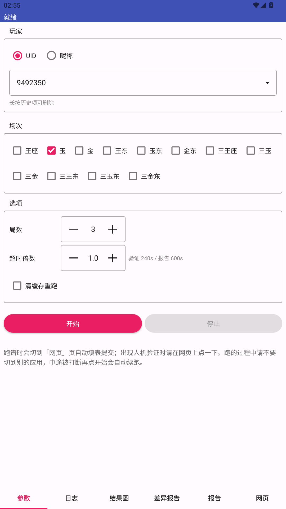
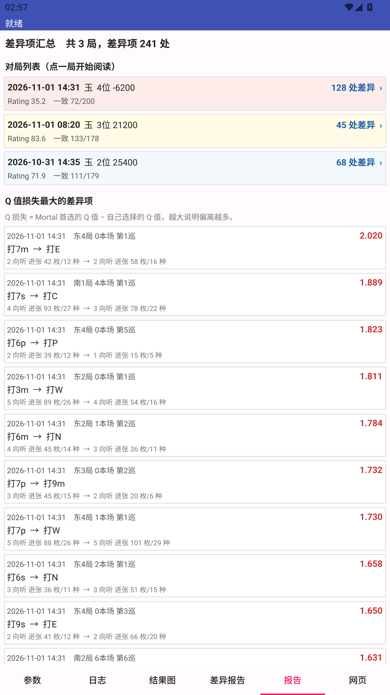
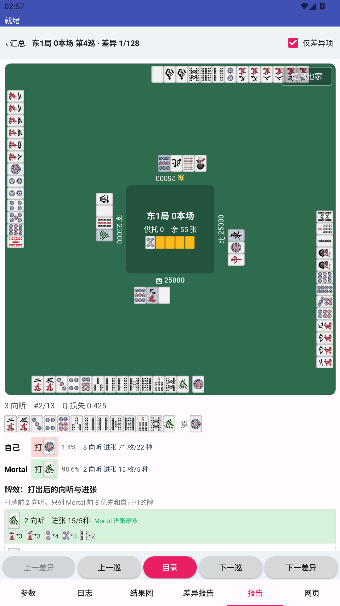
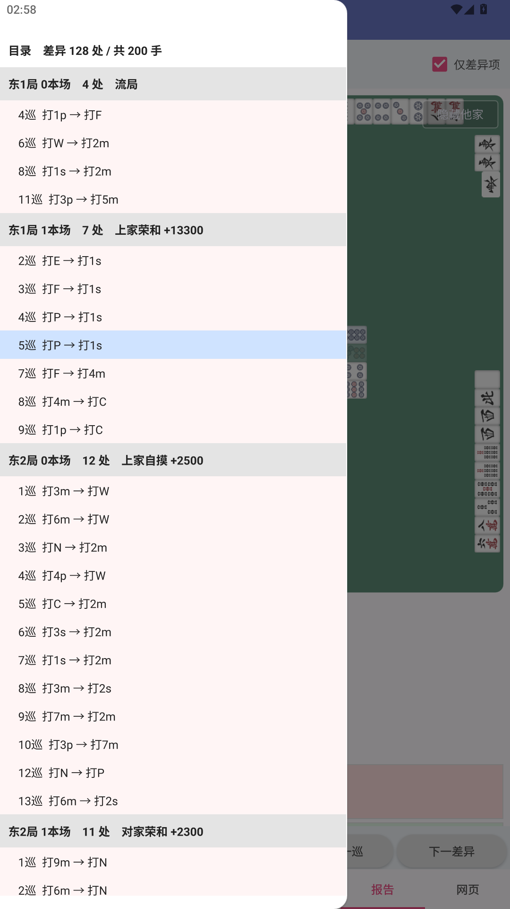

# 雀魂 Mortal Rating（安卓版）

桌面版的安卓移植。输入雀魂 UID 或昵称，应用在手机上取对局、提交 [mjai.ekyu.moe](https://mjai.ekyu.moe) 用 Mortal 4.1b 跑谱，并在应用内显示 Rating 走势和 Mortal 差异报告。

桌面版见仓库根目录的 [README](../README.md)。

## 与桌面版的区别

| | 桌面版 | 安卓版 |
|---|---|---|
| 界面 | tkinter | PySide6 + QML（入口 `qtapp/`） |
| 网页访问 | Playwright 经 CDP 控制本机浏览器 | 应用内 QtWebView，`webbackend.py` 驱动页面 |
| 走势图 | matplotlib 出 PNG | `chart_svg.py` 直接输出 SVG |
| 差异报告 | 浏览器打开 HTML | `qtapp/qml/diff/` 里的原生阅读器 |
| 包名 / 版本 | `MajsoulRating-Setup-<版本>.exe` | `org.majsoulrating.majsoulrating`，2.0.0 |

## 截图

| 首页 | 走势图 |
|---|---|
|  |  |

| 选择对局 | 差异概览 |
|---|---|
|  |  |

| 差异阅读器 | 目录 |
|---|---|
|  |  |

## 借鉴与依赖的项目

| 项目 | 用途 |
|---|---|
| [Qt for Python (PySide6)](https://doc.qt.io/qtforpython-6/) 6.12.0 | 界面、QML、QtWebView；用 `pyside6-android-deploy` 打包 |
| [Buildozer](https://github.com/kivy/buildozer) 1.6.0 / [python-for-android](https://github.com/kivy/python-for-android) | 构建 APK，提供安卓上的 Python 运行时 |
| [NumPy](https://numpy.org)、[Matplotlib](https://matplotlib.org) | 统计与部分绘图 |
| [MahjongRepository/mahjong](https://github.com/MahjongRepository/mahjong)（MIT） | 向听数计算 |
| [amae-koromo](https://github.com/SAPikachu/amae-koromo) | 雀魂牌谱屋，对局与统计数据来源 |
| [Mortal](https://github.com/Equim-chan/Mortal)、[mjai-reviewer](https://github.com/Equim-chan/mjai-reviewer) | AI 引擎与线上跑谱服务 |
| [WarL0ckNet/tile-art](https://github.com/WarL0ckNet/tile-art) | 牌面素材，已预渲染成 PNG 精灵图 |

## 代码模块

| 路径 | 功能 |
|---|---|
| `qtapp/main.py`、`qtapp/launch.py` | 安卓入口。构建时 `launch.py` 被复制成包内的 `main.py`，旧入口改名为 `legacy_main.py` |
| `qtapp/backend.py` | 后端：运行、历史、停止、走势图、差异报告数据 |
| `qtapp/diff_data.py` | 把 mjai 报告转成结构化数据，供 QML 渲染 |
| `qtapp/models.py` | 列表模型和差异阅读导航（当前决策点、上一个/下一个、目录） |
| `qtapp/qml/` | `Main`、`RunPage`、`ReportPage`、`ChartPage`、`LogPage`、`SessionWebPage`、`DiffPickPage`、`DiffSummaryPage`、`DiffReaderPage`、`TocDrawer` |
| `qtapp/qml/diff/` | 牌桌、副露、动作、牌效的 QML 组件 |
| `webbackend.py` | 程序内网页提交：注入 `mobile/ama_hook.js` 抓牌谱屋数据，填 mjai 表单，轮询报告 |
| `mobile/ama_hook.js` | 注入牌谱屋页面的脚本，收集对局请求结果 |
| `mahjong_rating.py` | 抓取、提交、轮询、统计的核心逻辑，与桌面版共用 |
| `store.py` | 数据目录与平台判断；`IS_ANDROID` 在这里决定 |
| `diff_report.py`、`efficiency.py`、`chart_svg.py`、`report_server.py` | 差异数据、向听、SVG 图、本地只读报告服务 |
| `main.py`、`app_backend.py`、`qml/` | 旧版界面，保留作对比 |
| `android_build/` | WSL 里构建 APK 的脚本 |

安卓上 Python 没有系统 CA 证书。`main.py` 的 `_android_ca_bundle()` 把系统根证书合并成 `cacert.pem`，`mahjong_rating._https_context()` 再把它显式交给 `urllib`。

## 直接安装

`MajsoulRating-2.0.0-arm64-v8a-debug.apk`(见仓库 Releases 页)是 debug 签名包，仅支持 arm64-v8a，最低 Android 9（API 28）。

```bash
adb install -r MajsoulRating-2.0.0-arm64-v8a-debug.apk
```

所需权限：`INTERNET`、`ACCESS_NETWORK_STATE`。

## 构建环境搭建

构建在 Windows 上通过 WSL2 的 Ubuntu 22.04 完成。本项目测试用的环境如下。

| 组件 | 版本 / 配置 |
|---|---|
| Windows | 10/11，启用 WSL2 |
| WSL 发行版 | Ubuntu 22.04 |
| WSL 资源 | 建议 16 核、48 GB 内存、16 GB swap（`%UserProfile%\.wslconfig`），首次构建会明显更快 |
| Python | WSL 内的虚拟环境 `~/mjr-android/venv` |
| PySide6 / shiboken6 | 6.12.0 |
| Buildozer | 1.6.0 |
| Android SDK / NDK | API 35，NDK 28.2.13676358，`minapi` 与 `ndk_api` 均为 28 |
| 架构 | `arm64-v8a` |

`%UserProfile%\.wslconfig` 示例：

```ini
[wsl2]
memory=48GB
swap=16GB
processors=16
```

### 步骤

1. 在 WSL 里先用 root 执行 `android_build/setup_root.sh`，安装 `build-essential`、`openjdk-17-jdk-headless`、`lld`、`ccache` 等系统包。
2. 在 Windows 上下载 Qt for Python 6.12.0 的安卓 wheel，放进 `android_build/wheels/`。再用普通用户执行 `android_build/setup_user.sh`，它会安装 Android SDK（platform-tools、android-35、build-tools 35.0.0、NDK 28.2.13676358）和 `~/mjr-android/venv`（PySide6 6.12.0、buildozer、Cython 等）。`fix_sdk.sh` 用于修复 SDK 的 `tools` 目录缺失。
3. 网络：`setup_user.sh` 把 `HOST:57778` 写死为代理，`net_env.sh` 探测 `HOST:57777`，能连通就走代理，否则直连。换了代理端口就改这两个文件。`net.sh` 和 `probe_proxy.sh` 用来检查连通性。`offline_git/git` 是一个 git 替身，让 `fetch`、`pull`、`submodule` 直接返回成功，用于构建时不想访问网络的情况，其他子命令仍交给系统 git。
4. 首次完整构建：

   ```bash
   bash android_build/build_app.sh
   ```

   它把源码同步到 `~/mjr-android/build/MjrSpike/`，生成 `buildozer.spec`（`requirements = python3,shiboken6,PySide6,numpy,matplotlib,mahjong`），再调用 `pyside6-android-deploy`。
5. 之后只改了 `.py`、`qml`、`mobile`、`assets` 时，用增量构建，耗时从约 16 分钟降到约 2 分钟：

   ```bash
   QT=1 bash android_build/fast_build.sh
   ```

   `QT=1` 表示以 `qtapp` 为入口。脚本里的源码路径取自脚本所在目录的上一级，所以整个目录可以放在任何位置。
6. 产物位于 `~/mjr-android/build/MjrSpike/MajsoulRating-2.0.0-arm64-v8a-debug.apk`。

### 在模拟器上调试

```bash
adb connect 127.0.0.1:16384            # MuMu 12 的默认端口
adb -s 127.0.0.1:16384 install -r MajsoulRating-2.0.0-arm64-v8a-debug.apk
adb -s 127.0.0.1:16384 logcat | findstr python
```

`android_build/uitext.ps1` 可以抓取界面文字，`watch_run.ps1` 可以持续观察运行日志，两者都支持传入设备序列号。

## 已知情况

- 构建产物是 debug 签名，不能直接上架应用商店。
- 应用没有前台服务和 WakeLock。跑谱期间切到后台或熄屏，系统可能限制网络，建议保持应用在前台。
- 更早的构建里，HTTPS 报告轮询曾因证书校验失败返回 HTTP 0，已在 `mahjong_rating._https_context()` 修复。
